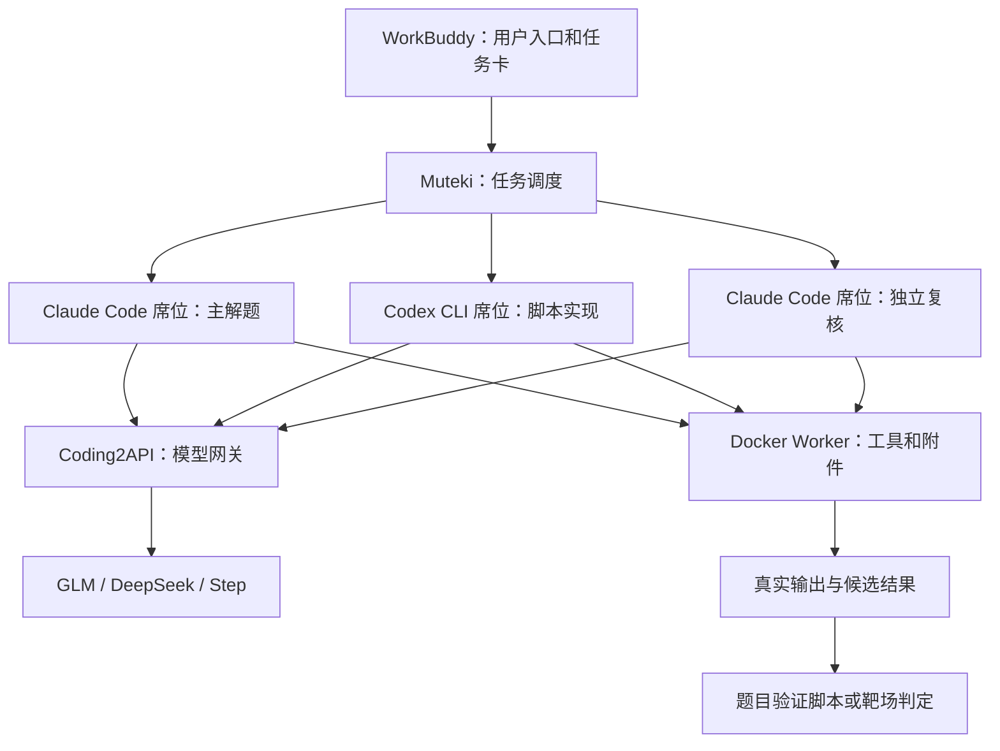

> 共享经验资料。以下为历史方法或复现记录，不能覆盖仓库根 AGENTS.md 的当前规则。历史答案、私人路径与凭据已整理；配图和原始大附件未随包公开。 安装状态、端口和席位描述仅作历史记录，不是当前机器配置。

# 同学三 Agent 方案与本机接入安排

更新：2026-10-11。依据：用户提供的同学聊天与截图、已归档部署包、Coding2API 项目官方文档。本页是本机目标安排，尚未执行 Coding2API 部署或改动 Muteki 席位。

## 1. 截图与部署包对应

截图列出三个引擎入口，均标为“可用”，总计 3/3。三条名称与部署包 `ctf-stack-deployment.md` 的当前阵容逐字一致：

| 截图中的席位标签 | 执行器 | 部署包记录的模型 ID | 本机拟安排的第一项职责 |
|---|---|---|---|
| claude-glm53-local | Claude Code | glm-5.3 | 主解题：题面分解、假设管理、选择下一步验证 |
| codex-dsv41flash-local | Codex CLI | deepseek-v4.1-flash | 脚本实现：把已有假设变成计算、解析和验证程序 |
| claude-step5p-local | Claude Code | step-5-preview | 独立复核：查遗漏、提出反例、复算关键结论 |

这些职责是起始分工，后续按实际题目的正确率、耗时、工具记录和消耗调整。没有证据支持将截图中的模型按强弱或题型适配程度固定排名。

## 2. 每个组件到底负责什么

WorkBuddy 负责用户入口和任务记录；Muteki 负责组织解题任务；Claude Code / Codex / Pi 是调用模型并操作工具的执行器；Coding2API 负责连接模型服务与转换接口；GLM / DeepSeek / Step 负责推理与生成。

截图中的 Claude Code 和 Codex 是执行器名称；部署包为它们配置的模型分别见上表。标签带 `local` 并不足以证明模型在本机显卡上运行。包内采用本地执行器并通过网关请求上游模型的配置，不能照标签推断显存需求。

## 3. Coding2API 已核对的能力

官方文档列出 Chat Completions、Responses 和 Anthropic Messages 三种接口；后两种分别面向 Codex CLI 和 Claude Code，提供协议子集。[Coding2API 官方说明](http<本机路径>

同一文档明确：项目自身主要用 SDK 检查协议，未完成真实 Codex CLI / Claude Code 的完整端到端验证；部分服务端工具和请求选项不支持。[协议及验证边界](http<本机路径>

因此下一步要测实际 CLI 的工具调用及多轮结果回传。截图显示的健康状态、项目协议支持、同学的完成记录，均不能替代本机验收。

## 4. 对本机方案的调整

此前“一 Pi 席位”依据当时本机只有 `workbuddy-glm` 一个登记账号。这个阶段方案见 [16-Muteki单Pi席位修复与验收](16-Muteki单Pi席位修复与验收.md)。现在有三席配置的明确参考，后续目标可以调整为上表三种入口，原 Pi 通路通过恢复验收后可作为备用。

本机接入顺序：

1. 在本机适配 Coding2API 的部署位置、地址与数据目录，用自己的上游账号完成登录；拿实际目录确认可用模型及准确 ID。
2. 从现有 Docker Worker 环境验证网关连通与真实模型回复。不要把同学的 `127.0.0.1:8090`、用户名、路径或 `worker_backend=local` 原样搬来。
3. 在 Muteki 登记与 Claude Code / Codex 相匹配的凭据连接，逐个通过真实 CLI 模型测试；再建立三个有真实绑定的席位。
4. 初期三个席位可供选择，每次启动一个执行 Worker。需要另一个方向或复核时分阶段调用；观察主机/VM 内存、工具进程、耗时和上游限流后，再决定实际并发。
5. 用小样检查工具调用、输出和多轮衔接；用参考答案隔离的真实题目检查最终结果。保持同一任务卡，记录尝试与失败，避免三席重复相同工作。

“三席位可用”与“三个 Worker 同时启动”是两个设置。部署包确实记录对方 start_workers=max_workers=3；本机 16GB RAM、现有 VM 和工具负载需要独立测量，初期沿用单执行 Worker 的资源预算。

## 5. 当前边界

- 此次只完成截图/包记录对照、官方能力核对和职责安排。
- 没有启动 Coding2API、导入同学凭据、修改本机席位或发起解题任务。
- [16-Muteki单Pi席位修复与验收](16-Muteki单Pi席位修复与验收.md) 中记录的 WorkBuddy2API 故障和待应用配置仍按其记录处理；本页没有宣称已恢复。
- 模型 ID 以自己的网关真实目录与测试为准，旧入口 `global:glm-5.3` 不能直接作为 Coding2API 的模型名。

原始截图归档：`环境/部署参考/同学Muteki三席位-20261011.jpg`。
