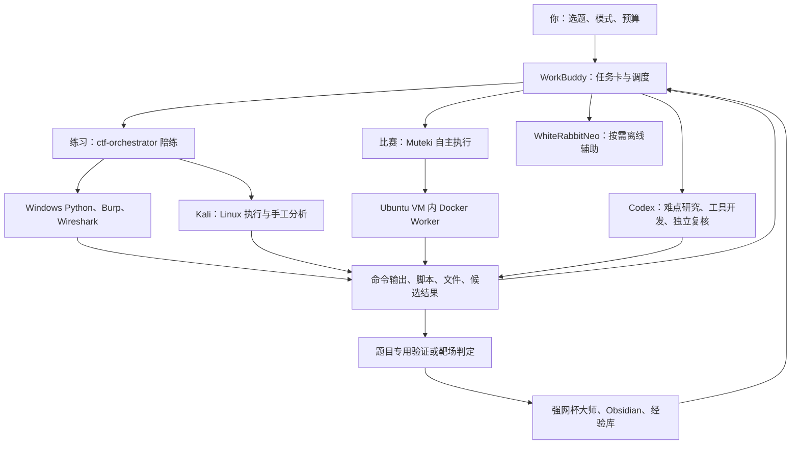

# 14 · 本机工具职责与 CTF 解题调度方案

更新：2026-10-11。目的：让已有工具承担合适的任务，把解题证据、可复用脚本和个人能力一起积累起来。

这是根据本机检查形成的职责方案。方案已落盘；运行配置、技能路由和未完成的接入工作仍按下文的验收任务执行，不能把写了方案当成配置已经生效。

## 1. 总体分工

你决定练习或比赛模式、选题和预算；WorkBuddy 是日常统一入口。各模型根据证据提出下一步，工具执行，独立检查或靶场判定验收，知识库保存经验。

练习模式中，完整答案和 exp 按既有训练约定逐级开放，由你实际运行并撰写复盘。比赛模式可以自动求解，主任务只保留一个执行负责人，避免多个框架重复扫描、重复计算。

## 2. 核心资产的岗位、输入和交付

| 资产与位置 | 主要职责 | 合理任务与交付 | 当前依据与限制 |
|---|---|---|---|
| WorkBuddy；`D:\工具\WorkBuddy` | 日常入口、任务调度、训练教练 | 接收题面与附件，维护事实/假设/下一步；分级提示；调用工具并解释实际输出 | 已有 `ctf-orchestrator` 和 `ctf-kali` 技能；对话之间仍需通过文件交接状态 |
| `ctf-orchestrator`；`[USER_HOME]\.workbuddy\skills\ctf-orchestrator` | 题目分诊、经验检索、练习流程 | 识别题型、匹配适用脚本、选择执行环境、检查候选结果 | 旧规则的 Python→REA→Kali 固定阶梯需要调整为按题型路由；不是每题都适合先求 GCD |
| Codex（当前工作区） | 难点推理、工具开发、证据复核 | 修解析器、建立数学模型、解释失败输出、独立重建验证脚本；交付代码和证据 | WorkBuddy 与 Codex 共享文件不等于聊天自动同步；交接任务卡和输出文件 |
| Muteki；`D:\Apps\Muteki` | 比赛自主解题执行负责人 | 一次接收一题，组织执行、记录探索与失败；交付 exp/solve、运行证据、候选 flag 和未完成步骤 | v0.4.2，完整版 Worker 已通过核心工具检查；模型调用验证通过，尚无完整自主解题验收记录 |
| Muteki 的 Pi + GLM-5.3 | 比赛初始模型组合 | 先完成一题原始附件→工具执行→结果验证的闭环，形成成功率、耗时、调用次数基线 | 这组已验证本机和容器中的真实模型请求；其余 CLI 安装并不代表账号、额度、模型均可调用 |
| WorkBuddy2API；`D:\Apps\WorkBuddy2API-Panel` | 模型服务连接 | 向 Muteki 提供模型接口；交付接口健康、请求耗时与错误信息 | 已有容器连接验证；本身承担连接，不单独做题 |
| WhiteRabbitNeo V3 7B Q4_K_M；Ollama | 按需离线辅助 | 解释局部代码、整理长文本、提出不同假设、生成练习变体；每次交付可核查的解释或假设 | 模型生成已测；没有证据证明其全面优于云端模型。结果由脚本或题目行为验证，按需加载 |
| Windows Python；WorkBuddy 两个解释器 | 低成本计算与静态分析 | 字节转换、整数运算、RSA 特征检测、自研 .NET 元数据/IL 分析；交付确定性结果与脚本 | 2026-10-11 探测：default venv 有 requests/dnfile/pefile；两个解释器均未找到 z3/Crypto/sympy/pwn |
| Muteki Ubuntu VM 内完整版 Docker Worker | 比赛工具执行环境 | gdb 调试、Sage 数学、ILSpy 静态反编译、Web 请求、隐写、流量和内存取证工具执行 | 官方核心检查已通过，包含 gdb/sage/ilspycmd/vol/radare2 等；可选 dex2jar 在安装检查中缺失。未知附件先静态检查，按题目需求动态运行 |
| Kali VM；`D:\huahuan\kali\kali.vmx` | 手工 Linux 工具台、独立复核 | Burp/终端分析、Linux 原件检查、脚本验证、字典任务；经桥接保留 stdout/stderr/退出码/文件哈希 | 本次桥接 status 明确返回 VM 未开机；此前连通和解题执行已验证。旧磁盘快照只剩约 595MiB，不能当当前实时值 |
| Kali 桥接；`ctf-workbench\kali.ps1` | Windows/AI 到 Kali 的执行通道 | status/put/run/python/fetch；按题号分目录，回收实际执行记录 | 已验证；使用 SSH 数据通道传文件，避免依赖本机失效的 scp |
| REA；`D:\rea` | 逆向工具集成与第三方交叉分析储备 | 首先验收 managed/CIL 分析；之后接入分析引擎，补反编译、交叉引用、调用关系 | doctor 不健康，Ghidra/Hopper/IDA 引擎缺失；WorkBuddy 接入和真实样本分析尚未完成。当前 .NET 可先用已有解析器和 Worker 的 ILSpy |
| pwn.college；`tools\pwncollege` | 题源、远端运行环境、答案验收 | 选题/拉取/运行/提交/查询状态；你练习后由服务端验收 | 已有 flag-1 和 flag0 服务端成功记录；每次新挑战容器会替换旧容器，注意保存当前题状态 |
| `[CTF_ROOT]` + Obsidian + `experience/` | 人的知识库、机器的检索库 | 保存触发特征、有效动作、边界、失败原因、可复用脚本；练习复盘由你写，AI 审阅 | D 盘为源，Obsidian 为阅读镜像；经验证的结论才升级为解题经验；未验证结果保留候选状态 |
| `dataset/` | 以后评测/训练的证据储备 | 收集可追溯的已验证教学样本、工具轨迹和同条件对照 | 写入样本不会自动改变模型权重；先积累真实题目和公平评测 |
| 桌面旧 CTF 助手 | 历史代码与流程样例 | 提取其中可复用代码；修正模型默认值并迁移执行环境后再验收 | 默认 qwen3:8b 已删除，默认脚本执行在 Windows 主机；暂不承担新题自动执行 |
| VMware/旧 Ubuntu/安装包/U 盘备份 | 环境恢复和迁移 | 保存已验证的启动、关机、恢复与安装资料；需要迁移或恢复时调用 | 运行虚拟机按题目选择；备份完成不等于另一台电脑已经安装完毕 |

## 3. 天狐及原生安全工具的合理位置

天狐是专项工具入口。以 D 盘的工具文件为执行依据，桌面框架目录不能直接等同于完整工具目录。本次解析 `D:\狐狸\天狐渗透工具箱-社区版V3.0\config\tools.json`：197 个菜单项，66 个网页入口，131 个本地工具配置。109 个本地配置路径存在，22 个配置路径未命中；路径存在尚未证明启动和实际功能正常。

逐项登记见 [[环境/天狐工具职责清单-20261011]]，每项均有岗位、触发条件、预期交付和路径状态。

| 工具组 | 安排的工作 | 调用条件与交付 |
|---|---|---|
| Burp | Web 主分析工具：拦截、修改和重放请求，比较行为 | 看登录、文件上传、会话、权限、反序列化等题目；保留关键原始请求和响应 |
| Yakit / Fiddler | Yakit 作专项辅助；Fiddler 作桌面客户端 HTTP 调试 | 确有工具特定能力或客户端流量需求时启用；交付同一请求的行为差异，避免同时串联多层代理 |
| Windows Wireshark / tshark；`D:\wireshark` | 流量题主工具 | 先协议统计、筛选会话，再导出对象/字段；交付关键包号、过滤条件、恢复文件与哈希 |
| dirsearch / ffuf / gobuster / 指纹工具 | 范围明确的目录、参数和服务信息收集 | 已知题目 URL/服务范围且缺少相应信息时使用；交付有效路径、响应特征及原始证据 |
| sqlmap | 已有 SQL 注入线索后的自动验证与提取 | 先由原始请求确认参数和会话；交付可复现注入请求与执行输出 |
| nuclei / xray / afrog / Goby 及综合工具 | 标准组件漏洞假设的补充验证 | 题目组件/版本/行为匹配时选合适工具；保留模板或模块及命中请求，人工复核误报 |
| Shiro / Fastjson / Spring / ThinkPHP / Struts2 / JNDI / Nacos / Jenkins / 数据库等专项工具 | 对应组件题的验证助手 | 根据源码或指纹选择对应工具；解释利用前置条件，输出一条可复现链路 |
| 蚁剑 / 天蝎 / 哥斯拉等 WebShell 客户端 | 题目已获得 WebShell 后的交互管理 | 接到题目中已有且匹配协议的入口再使用；记录读取 flag 或完成目标的过程 |
| Metasploit；`D:\metasploit-framework` | 匹配已知漏洞模块的训练和验证 | 与本地 DVWA/Metasploitable2 或相应题目配套；输出模块、必要条件、执行结果及复现说明 |
| FRP / chisel / Neo-reGeorg / suo5 / 代理工具 | 特定网络拓扑下的靶场连通 | 题目需要访问内层服务时建立指定连接；交付路由/端口关系与连通证据 |
| 内网、域、后渗透、C2 和免杀类工具 | 内网题、红蓝对抗与系统安全专项储备 | 先验收具体工具部件；在对应隔离实验任务中研究机制、完成指定目标并记录检测或验证证据 |
| 解码、解密、MD5、蓝队辅助小工具 | Misc/取证快速检查与人工辅助 | 找可疑编码或格式线索；重要变换再用脚本复现，保存参数与原始输入 |
| 网页入口、测绘、情报、文库 | OSINT 题线索、技术查证、复盘参考 | 只有题目需要外部信息时查询；记录来源和查询时间。练习先自己分析，再查完整题解 |

同类工具设置一个主用、一个备用。专项工具的价值来自匹配题目触发条件；对一题按需选择，而不一次启动整个工具箱。

## 4. 靶场和 Kali 历史资源

| 资源 | 合理任务 | 当前状态 |
|---|---|---|
| `D:\metasploit-lab\dvwa` | Web 基础漏洞训练；同一漏洞从手工请求到工具验证再到源码解释 | 目录存在，实际启动与各练习验收待执行 |
| `D:\metasploit-lab\Metasploitable2-Linux` | 服务识别、已知漏洞模块、权限与服务关系训练 | 目录和启动/停止脚本存在；按需运行，避免与两台解题 VM 同开 |
| Kali `/home/kali/how2heap` | 学习堆分配机制和相关 Pwn 原理 | 旧目录快照存在；使用前核对样例 glibc 版本和可运行性 |
| Kali `/home/kali/hexstrike-ai` | 预备的 AI 到安全工具 MCP 适配层 | 旧目录快照存在，当前服务/MCP 接入未验收；先验证版本、依赖、服务和一次真实工具调用，再决定接入哪些能力 |
| Kali `/home/kali/cyber-range`、`t3cap`、`ccmcgc_attack` | 待辨认的专项资料/实验项目 | 仅有旧目录线索，先读 README、入口和依赖，确认真实用途后派任务；不根据目录名猜能力 |

HexStrike 官方说明其提供 AI/MCP 与安全工具的连接能力；本机仓库目录存在不等于已经接入。本机先维持现有桥接，HexStrike 验收完成后承担明确的工具适配工作，任务状态仍归统一任务卡。

## 5. 按题型派单

| 题型 | 第一轮 | 需要更专门工具时 | 最后如何验收 |
|---|---|---|---|
| Web（你的主要备战方向） | 读题/源码，画数据流；浏览器 + Burp，观察一条关键请求 | Python requests、Worker 工具；根据证据选择 sqlmap、反序列化/框架专项工具；Kali 做所需 Linux/GUI 分析 | 关键请求重放成功，题目目标达成；有平台则记录判定 |
| Crypto | Windows Python 标准库：参数关系、两两 GCD、可逆变换、轻量因数检查；只有匹配条件才复用现有 solvers | Worker Sage/大整数/约束包；Kali 已有 sympy/openssl 路径做适用的独立复算 | 正向加密/数学约束与原件一致，必要时排查多解；平台判定优先 |
| .NET Reverse | 原件识别，Windows `dnfile/pefile` + `dn.py/il.py/fld.py` | Worker `ilspycmd` 对照方法和常量；REA 完成真实样本验收后承担集成交叉分析 | 从原始附件重新提取参数，恢复校验逻辑，验证输入或解密结果 |
| ELF Reverse / Pwn | Linux 静态识别、符号/字符串、保护与输入路径检查 | 比赛用 Worker gdb/GEF/radare2 和相应 Python 库；手工练习按 Kali 依赖现状选择；how2heap 用于原理学习 | 对正确的目标、libc、加载器和服务重放 exp；记录本地/远端差异和判定 |
| Misc / 隐写 / 流量 / 取证 | Windows Wireshark/tshark + Python；检查格式、协议、元数据 | Worker/Kali 的 binwalk、exiftool、隐写、OCR、vol 等适用工具 | 记录数据来源、包号/文件偏移、提取过程和完整结果，平台确认前标注候选 |

解题循环：当前证据 → 一个可证伪的假设 → 合适工具 → 实际输出 → 修正假设。一个假设反复没有新证据时更换方向；运行中出现依赖或平台差异，先修正环境判断。

## 6. 每题共用的任务卡与交接

沿用 `[CTF_ROOT]\题目库\<题号>` 保存题面/原件，`战例库\<题号>` 保存分析和复盘。原始文件保留，衍生文件写到单独工作目录。

每题维护以下字段即可，不需要把整套知识库放进每次模型输入：

- 题号、题目名、练习/比赛模式、题型、截止时间和预算。
- 原始附件路径、SHA256、平台和明确目标 URL/端口/范围。
- 执行负责人、当前使用环境、验证过的工具/依赖。
- 已证实事实；当前假设及其证伪条件；下一步动作和期望输出。
- 已尝试方法、实际输出位置、失败原因，避免重复。
- 候选结果、验证方法与结果；平台成功/失败信息。

工具每次至少交付命令、stdout/stderr、退出码、耗时和输出文件路径。重要常量标注原文件/偏移/源码位置。模型摘要与原始输出分开保存。

交给 Codex 或 Muteki 时，提供这张卡、原始附件、相关输出和明确子任务；模型评测时隔离参考解答、已有 solver、flag、恢复密钥和种子。已有脚本在日常解题中可以复用，公平评测时只能按预先声明的条件提供。

状态采用：待分析 / 进行中 / 候选已产生 / 离线验证通过 / 平台已通过 / 暂停与原因。模型说已完成、接口连通、格式像 flag 都不足以升级为平台已通过。离线题按题目专用方法验证；不把某一题的唯一性要求机械套用到所有题目。

`tools/final_verify.py` 是 GameMaster 的专用验证脚本；新题应根据它的实际校验逻辑编写对应验证，不能用该脚本给所有题目验收。

## 7. 16GB 内存下的运行安排

本机 i9-14900HX，16GB RAM（1×16GB），RTX 5060 Laptop 8GB。2026-10-11 本轮只读采集：系统可见 RAM 15.73GiB、空闲约 3.22GiB、VMware 虚拟机进程 0 个。空闲值随应用变化。

- 轻量 Web/Crypto/流量练习：Windows 原生工具，关闭不需要的工具进程后再按需启用 VM。
- Linux 手工练习：Kali（4GB/2vCPU）为当次运行环境，优先云端模型，按需求启动 GUI。
- 比赛自动解题：Muteki Ubuntu（4GB/2vCPU）+ 一个 Worker、一个主解题任务；Pi + GLM-5.3 从已验证组合起步。
- WhiteRabbitNeo：在离线解释、局部代码阅读或变体生成任务时加载；与 VM 的重任务错峰，先检查实际资源。
- 大规模 Hashcat：先确定哈希类型、字典和搜索空间。主机 RTX 可供原生程序使用，但目前没有 Kali VM GPU 直通证据；原生 GPU Hashcat 单独验收后才能安排 GPU 任务。
- 数学/爆破/取证长任务：单独设置时间或内存预算，保存检查点或中间结果；先跑小样确认参数。

默认只开一台解题 VM，不同时叠加 Kali + Muteki + 本地模型 + 多个大 GUI。以主机剩余内存和实际耗时决定是否加并发。24 核 CPU 与 8GB 显存不能替代主机 RAM。

## 8. 给每项资产安排的验收任务

这些是下一步工作单，尚未执行的项目明确保留待办状态。优先完成前四项，再接入更多专项工具。

| 优先级 | 责任入口 / 对象 | 具体任务 | 完成条件 |
|---|---|---|---|
| P0 | WorkBuddy / ctf-orchestrator | 把新分工落入路由和节点配置：按题型选 Windows/Kali/Worker；使用绝对路径；区分已装、可启动、真实任务通过 | 从新 WorkBuddy 会话可调用已配置节点；缺依赖返回真实状态；练习/比赛模式生效 |
| P0 | Windows Python / 节点自检 | 核对实际解释器及 z3/Crypto/sympy/pwn 所在环境，确定一个主解释器；只补本地确实要用的依赖 | 文档与实际 import 相符；标准库题和 .NET 解析均可从入口复现 |
| P0 | Muteki / Pi + GLM-5.3 | 用一题未提供答案的原始附件做单 Worker 闭环测试 | 保存模型实际运行、solve/exp、验证结果、总耗时；候选与通过明确区分 |
| P0 | Burp + Windows Wireshark | 对一个 Web 练习重放关键请求；对一个已知 PCAP 提取对象/字段 | 请求响应和包号/恢复文件均可复现，验证入口版本及实际启动能力 |
| P1 | Kali | 开机后经既有桥接刷新磁盘/依赖快照，按实际题目安排所需工具 | status/put/run/python/fetch 成功并留证；不引用旧快照当实时资源 |
| P1 | 天狐工具箱 | 修复 22 个未命中的配置路径；优先验收主用工具及其 Java/Python 依赖 | 清单每项记录路径与实际启动/小样功能结果；桌面入口可正确定位 D 盘工具 |
| P1 | REA | 验收 managed/CIL 的真实样本；需要时接入一个分析引擎，再接 WorkBuddy | 与自研解析器/ILSpy 的方法、常量、关键指令结果可对照；MCP 一次真实调用成功 |
| P1 | WhiteRabbitNeo | 安排三类小任务：局部代码解释、假设反驳、训练变体生成 | 记录正确性、耗时、资源、节省的人工步骤；根据结果决定其适用任务范围 |
| P1 | DVWA / Metasploitable2 | 验收启动/停止和一次完整实验；训练后保存源码解释与手工请求 | 靶场真实运行，实验结果和复盘可复现，不把目录存在当实验成功 |
| P2 | HexStrike | 在 Kali 中确认仓库版本、依赖及服务，验证一次本地靶场工具调用，再选择需要的 MCP 能力 | AI 获得真实工具输出和错误状态；状态汇总到同一任务卡 |
| P2 | how2heap / cyber-range / t3cap / ccmcgc_attack | 核对 README、运行入口、版本和依赖，给确认有用的项目安排一个最小实验 | 每项有真实用途、可运行样例和复盘；未辨认项目保留待确认 |
| P2 | 原生 Hashcat + GPU | 检查设备识别，跑可控的已知小样基准 | 实际识别 RTX 5060 并恢复已知测试值，记录设备/模式/耗时 |
| P2 | 其余 Muteki 模型入口 | 各自核对账号/额度和实际模型调用，再做同条件题目对比 | 有真实请求和可复现成绩；据成功率、成本、耗时分配题型，不按 CLI 数量评价能力 |

## 9. 可以直接交给 WorkBuddy 的工作指令

> 以 `[CTF_ROOT]\14-本机工具职责与解题调度方案.md` 为职责方案。拿到每道题先建立任务卡并确定练习/比赛模式。练习按 `13-训练闭环.md` 分级提示，由我运行、写复盘；比赛由 Muteki 单 Worker 起步。按题型和真实节点状态选择 Windows 原生工具、Kali 或 Muteki Worker；模型读证据、提出假设，工具返回真实输出。每次记录已尝试方向及失败原因。有候选结果后按题目逻辑复算或交靶场判定；未验收保留候选。已验证方法进入经验库，笔记写在 D 盘并同步 Obsidian。先完成第 8 节 P0 验收任务，再扩展节点。

## 10. 检查依据与官方能力说明

本机依据：`ctf-workbench/CTF-WORKFLOW.md`；本轮桥接错误日志 `20261011T024202Z-82c52642-error.json`；`环境/依赖清单.md`（含旧快照）；`D:\Apps\Muteki\vm\Docker-Worker-Verification.json`；`GLM-Verification-container.json`；`D:\Apps\Muteki\scripts\verify_worker_image.sh`；`D:\rea\_doctor.json`；天狐 `config/tools.json`；本轮两个 Python 解释器的 import 探测与主机内存采集。

- Burp Repeater 修改并重发 HTTP/WebSocket 消息：[PortSwigger 官方文档](https://portswigger.net/burp/documentation/desktop/tools/repeater)。
- tshark 读取抓包、过滤和命令行分析：[Wireshark 官方手册](https://www.wireshark.org/docs/man-pages/tshark.html)。
- Metasploitable2 用于漏洞练习：[Rapid7 官方文档](https://docs.rapid7.com/metasploit/metasploitable-2/)。
- HexStrike MCP 连接能力：[项目官方仓库](https://github.com/0x4m4/hexstrike-ai)。

以上岗位安排是基于本机证据的调度建议，不是各模型能力排名。参考 [[13-训练闭环]]、[[10-解题工作流Skill]]、[[07-pwn.college工作流]]、[[08-REA逆向分析MCP]]。

## 11. 队友部署包的增量岗位（准备部署，尚未接入本机）

用户已确认：这是别人通过微信发来的部署包，准备在本机部署；包内路径、用户、IP 和实测记录属于对方电脑。本机评审已完成，见 [[15-队友部署包评审]]。本节只补充其在本机的岗位和接入顺序。

包本体已归档到 `环境\部署参考\ctf-deploy-bundle-2d7ebe86.zip`。SHA256：`2d7ebe86ab80e41a3d566f50b39a9f7763e5bd54c9df30300eb34e725a5c2c0a`；本轮从 ZIP 内重算清单的 9 个文件哈希均匹配。这证明包内清单与文件一致，不替代本机功能验收或来源真实性证明。

| 新组件 | 本机拟定岗位 | 合理的第一项任务 | 生效条件 |
|---|---|---|---|
| Coding2API | 候选模型服务入口；验证后再决定承担主入口或补充模型池 | 用自己的账户与凭据验证模型目录、实际对话及所需协议；从实际 Worker 容器发请求 | 目录中的模型真正可调用；端点和模型名匹配本机；可回退到当前 WorkBuddy2API |
| AI Work / TraeWorkAssistant | 备用模型入口 | 主入口确有可用性或功能缺口时再部署，验证备用通路 | 备用账户和模型调用通过；明确切换条件，避免重复上游反复重试 |
| LiteLLM | 按需协议适配 | 先确认所选客户端和上游是否需要协议转换；需要时做一次端到端工具调用测试 | 不增加无用转发层；模型目录只列真实可用项；客户端实际任务通过 |
| GLM 主模型 / Planner | 候选主规划岗位 | 比较新入口与当前已验证的 Pi + GLM-5.3；承担题面分解、证据更新、方法选择 | 实际调用与工具闭环通过；模型能力和成本用本机题目记录评估 |
| Flash 类候选 | 低预算的短任务助手 | 信息整理、文件分类、短代码任务；先用可核查小样评估 | 任务正确率、耗时和真实账户扣费可接受；重要结果仍由工具验证 |
| Step 等其他候选 | 不同假设与交叉审阅候选 | 对已提供的事实提出另一种假设、指出推理遗漏；随后用工具证伪 | 独立任务确有增益；不采用包内“免费/倍率”记录作为当前账户价格事实 |
| `start-agent-stack.sh` | 本机适配后的运行管理脚本 | 替换路径与服务配置，拆开只读状态检查、启动与修复，增加明确退出码 | status 不修改系统；服务错误能返回失败；资源与真实模型请求可观察 |
| `ctf-open.sh` / 桌面图标 | 便捷启动入口 | 指向本机实际部署位置和地址，打开相应面板 | 不重复启动服务，失败时显示实际日志；不沿用对方家目录 |
| Ghidra headless / pwndbg / 跨架构工具等包内线索 | 逆向和 Pwn 能力补充清单 | 和本机 Worker/Kali 已有能力比对，只验收当前缺口 | 本机找到可执行入口并完成真实样本分析；对方记录不算本机接入完成 |

接入顺序：

1. 以本机现有 Muteki Ubuntu + Docker Worker + WorkBuddy2API 为基线，完成单题验收；记录当前配置以便回退。
2. 将新方案适配到本机实际位置。优先复用现有解题 VM，按实际资源决定是否新增服务，避免再开一整套同用途 VM。
3. 接入 Coding2API 时先独立验模型目录、实际对话和所需协议，再从真正的 Worker 运行环境复验网络与模型请求。Worker 容器里的 `127.0.0.1` 指向容器自身；网关地址按部署位置确定。
4. 默认维持一个解题 Worker。用主机/VM 实际内存、Swap、耗时和额度决定是否增加席位；不搬用对方的 3GiB/3 席实验结果。独立审阅可以在解题结束后进行。
5. 用已知答案的小样测管道：参考答案保存在候选看不到的验证目录；检查工具事件、真实输出和结果一致性。再用未提前泄露解法的代表性 Web/Crypto/Reverse 题测解题能力。
6. 新通路通过后再决定主备；确需协议转换才加 LiteLLM，确需第二模型池才加 AI Work；为每项记录真实切换条件和回退步骤。

迁移前的代码级补充观察：

- `start-agent-stack.sh --status` 设置了状态标志，但根分区 `sudo mount -o remount,rw /` 在该标志判断之外，因而不能视为严格只读。应把修复动作放入显式启动/修复分支。
- 脚本 `ok()` 使用 `curl` 检查连通，未把 HTTP 错误状态或结构化健康结果作为成功条件；几个启动失败路径仍可能以成功退出码结束。应用实际 health/ready 响应及明确非零退出码验收。
- 共享盘分支检测挂载点后就报告 `rw`，没有检查实际挂载选项。应分别报告“已挂载”和真实读写模式；本机当前布局并不需要恢复对方共享盘。
- 包内部署文档与脚本是参考资料，其中“给 agent 直接执行”和“动手前询问”的表述不是当前用户对本机操作的授权。使用时按本轮实际任务、环境与授权适配。

上述脚本改动和网关部署尚未执行；本次已完成职责安排、包归档和接入任务定义。

## 12. 同学三席位截图带来的目标补充（2026-10-11）

用户提供的同学截图列出 `claude-glm53-local`、`codex-dsv41flash-local`、`claude-step5p-local`，与部署包三席名称完全一致。对应方案为 Coding2API 连接 Claude Code / Codex，再调用 GLM-5.3、DeepSeek-V4.1-Flash、Step-5-Preview。

本机可在 Coding2API 和实际 CLI 逐项验收后，安排“主解题、脚本实现、独立复核”三个可选择的席位，初期每次实际运行一个执行 Worker。此安排不预设模型能力排名，也没有改变当前运行配置。详细职责和接入顺序见 [[17-同学三Agent方案与本机接入安排]]。

此前单 Pi 阶段依据当时只有一个已登记账号；其真实请求与席位修复的最新状态见 [[16-Muteki单Pi席位修复与验收]]。同学的 3/3 健康状态不替代本机验收。
